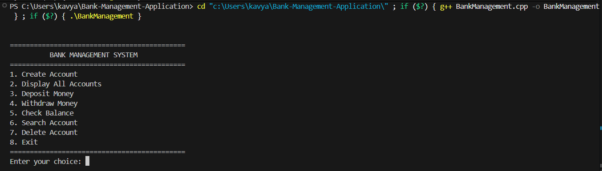

# Bank Management Application

A console-based Bank Management Application developed in C++ to simulate basic banking operations using object-oriented programming and file handling.


## Overview

This application allows users to manage bank accounts through a menu-driven interface. It supports common banking operations while storing account information persistently in a local file.

The project demonstrates how classes, objects, vectors, and file handling can be used to build a simple banking application in C++.

## Features

- Create new bank accounts
- Display all account details
- Deposit money
- Withdraw money
- Check account balance
- Search accounts using account number
- Delete an account
- Prevent duplicate account numbers
- Validate transaction amounts
- Prevent withdrawals exceeding the available balance
- Store account records persistently using file handling

## Technologies Used

- C++
- Object-Oriented Programming (OOP)
- Classes and Objects
- File Handling
- Vectors
- String Streams
- Standard Template Library (STL)

## Project Structure

```text
Bank-Management-Application/
│
├── BankManagement.cpp
├── README.md
├── .gitignore
├── LICENSE
└── demo1.png
```

The `accounts.txt` file is generated locally when account information is saved. It is excluded from Git through `.gitignore`.

## Demo



The application uses a menu-driven interface to manage accounts and perform basic banking transactions.

## How to Run

### 1. Clone the Repository

```bash
git clone https://github.com/KavyanshGarg/Bank-Management-Application.git
```

### 2. Open the Project

Open the cloned `Bank-Management-Application` folder in Visual Studio Code.

### 3. Compile the Program

Make sure a C++ compiler such as GCC is installed and available in your terminal.

```bash
g++ BankManagement.cpp -std=c++17 -o BankManagement
```

### 4. Run the Program

**Windows (PowerShell):**

```powershell
.\BankManagement.exe
```

**Linux/macOS:**

```bash
./BankManagement
```

## Banking Operations

The application provides the following menu options:

```text
============================================
          BANK MANAGEMENT SYSTEM
============================================
1. Create Account
2. Display All Accounts
3. Deposit Money
4. Withdraw Money
5. Check Balance
6. Search Account
7. Delete Account
8. Exit
============================================
```

## Data Storage

Account information is stored locally in a file named `accounts.txt`.

The application reads saved records when needed and updates the file after account creation, deposits, withdrawals, and deletions. This allows account records to remain available when the program is restarted.

The `.gitignore` file excludes `accounts.txt` and compiled executable files from Git so that local data and generated binaries are not uploaded to the repository.

**Note:** This is an educational console application. It stores records in a local text file and is not designed for real banking transactions or production use.

## Concepts Demonstrated

- Object-oriented programming
- Classes, objects, and member functions
- File input and output
- Vectors and data structures
- Searching and record management
- Basic transaction validation
- Menu-driven program design

## Future Improvements

- PIN-based account authentication
- Transaction history
- Improved account validation
- Database integration
- Graphical user interface (GUI)

## Author

**Kavyansh Garg**

## License

This project is licensed under the MIT License. See the [LICENSE](LICENSE) file for details.